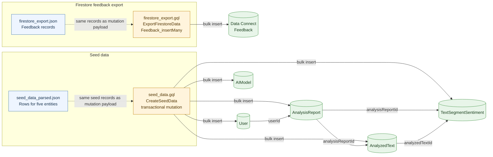

# Data Connect data flow

This diagram shows how the four files pair up and what each bulk-insert mutation
loads. The two paths are separate: the feedback export is not part of the seed
data mutation.

Files represented: [firestore_export.json](./firestore_export.json),
[firestore_export.gql](./firestore_export.gql),
[seed_data_parsed.json](./seed_data_parsed.json), and
[seed_data.gql](./seed_data.gql).

The dashed arrows indicate that each JSON file contains the records represented
by its corresponding GraphQL mutation. The solid arrows show inserts and the
ID references present in the seed payloads.
